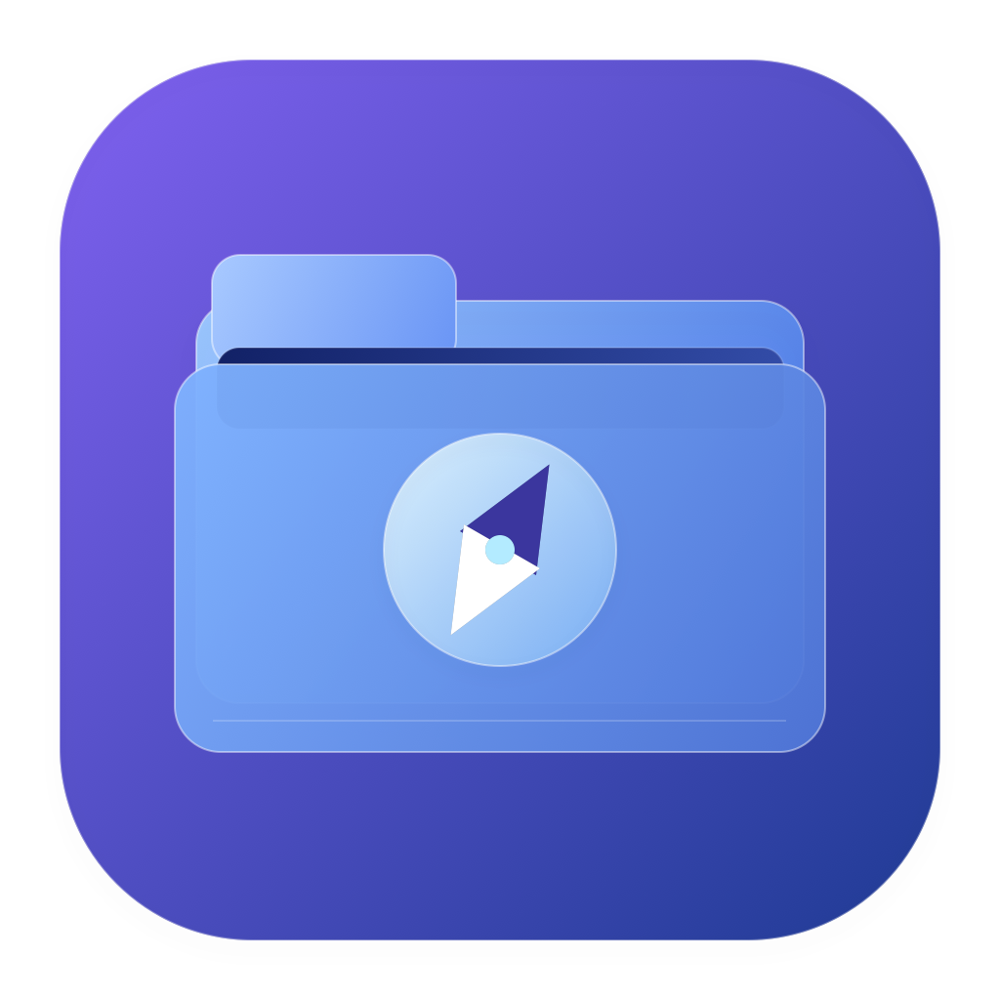
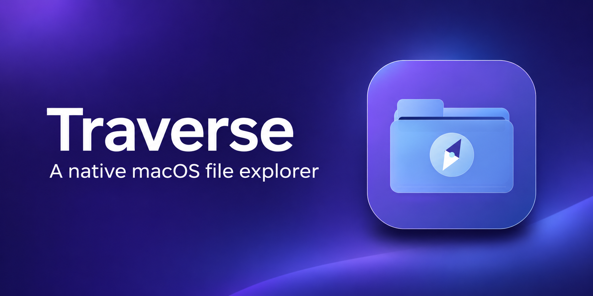
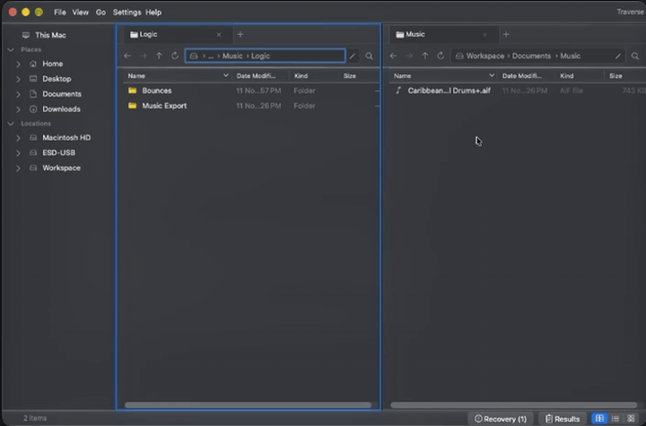
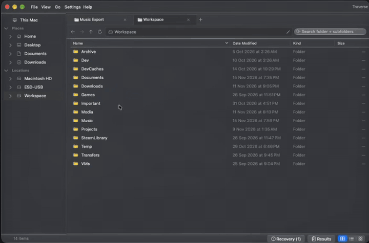
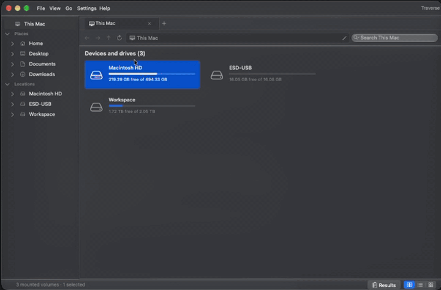
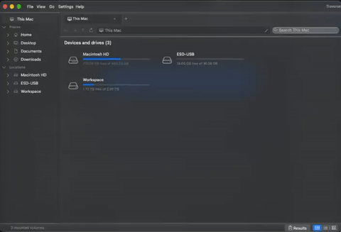

<p align="center">
  
</p>

<h1 align="center">Traverse</h1>

<p align="center">
  <a href="https://github.com/Respawn-Studios/Traverse/releases/latest"></a>
  <a href="docs/engineering/DEVELOPMENT_SETUP.md"></a>
  <a href="docs/engineering/DEVELOPMENT_SETUP.md"></a>
  <a href="LICENSE"></a>
  <a href="https://discord.gg/UdKp2uQBQy"></a>
  <a href="https://buymeacoffee.com/respawnstudios"></a>
</p>

<p align="center">
  
</p>

<p align="center">
  A native Mac file explorer by <strong>Respawn Studios</strong>. Keep folders side by side,<br>
  move between local files and servers, work inside archives, and edit text<br>
  without leaving your workspace.
</p>

<p align="center">
  Traverse is <strong>free and open source under <a href="LICENSE">GPLv3</a></strong> for<br>
  <strong>Apple Silicon and Intel Macs running macOS 15 or later</strong>.<br>
  This is an early release, and we'd love your feedback. Check the release notes<br>
  for what's included in your download, especially an older beta.
</p>

<p align="center">
  <strong>Built with help from OpenAI Codex</strong><br>
  I'm building Traverse with substantial assistance from Codex for coding,<br>
  debugging and testing. Its help has brought this project to life much sooner<br>
  than the months it would have taken me working alone.<br>
  I'm using this project to learn Swift-based app development as I go.<br>
  I still guide the project and take responsibility for what ships.
</p>

<p align="center">
  <a href="https://github.com/Respawn-Studios/Traverse/releases">Releases</a> ·
  <a href="docs/guides/features.md">Feature guide</a> ·
  <a href="https://github.com/Respawn-Studios/Traverse/wiki">Wiki</a> ·
  <a href="CHANGELOG.md">Changelog</a> ·
  <a href="PRIVACY.md">Privacy</a> ·
  <a href="CONTRIBUTING.md">Contributing</a> ·
  <a href="https://discord.gg/UdKp2uQBQy">Discord</a>
</p>

<table align="center">
  <thead>
    <tr><th align="center">Take a look</th><th align="center">Get involved</th></tr>
  </thead>
  <tbody>
    <tr><td align="center"><a href="docs/guides/features.md">What's in Traverse</a></td><td align="center"><a href="https://github.com/Respawn-Studios/Traverse/discussions">Suggest an idea</a></td></tr>
    <tr><td align="center"><a href="docs/ROADMAP.md">Where we're heading</a></td><td align="center"><a href="https://github.com/Respawn-Studios/Traverse/issues">Report a bug</a></td></tr>
    <tr><td align="center"><a href="https://github.com/Respawn-Studios/Traverse/releases">Downloads and release notes</a></td><td align="center"><a href="CONTRIBUTING.md">Build it yourself</a></td></tr>
  </tbody>
</table>

## Make room for your files

- **Tabs and up to four panes.** Keep a source folder beside its destination,
  open several locations in each pane, and move tabs between panes.
- **Direct handoffs.** Use Copy or Move to Other Pane for local files. Copy
  supported archive and server selections into a local pane, or send local
  items to a connected server pane.
- **A workspace you can return to.** Save layouts and profiles, keep folder-view
  choices, and navigate with breadcrumbs, an editable address and Back/Forward.
- **A sidebar that fits.** Pin folders, reorder categories and locations, resize
  the sidebar or hide it completely. The footer button brings it back at its
  previous width, with your expanded sections and ordering intact.

<p align="center">
  <a href="docs/media/tutorials/tabs-and-panes.gif"></a>
</p>

## Get everyday file work done

- **Cut, Copy and Paste in plain sight.** Use the toolbar, menus, context actions
  or keyboard. Create folders and text files, duplicate items, or put a selection
  into a new folder.
- **Rename with a preview.** Add text, replace text or number a batch of names.
  Review the Before/After list before applying the change.
- **Choose what happens at a collision.** Skip or Keep Both, with explicit Replace
  and folder Merge choices where supported. Inspect queued work, pause waiting
  jobs, stop an active operation and review its result.
- **Undo and native Trash.** Review recorded operations and restore eligible
  changes. Items moved to macOS Trash by Traverse stay together in its recorded
  Trash groups, with a dedicated Restore view.

<p align="center">
  <a href="docs/media/tutorials/folders-and-drag-drop.gif"></a>
</p>

[File operations, conflicts and recovery](docs/guides/features.md#file-operations-and-recovery)

## Work inside archives

- **Browse archives like folders.** Open ZIP, TAR, TAR.gz and TAR.bz2 tabs,
  navigate their folders, and preview supported text, hex and images.
- **Make changes inside.** Rename, add, remove, duplicate or move supported
  members, create files and folders, and edit text. Update the original or save
  a separate copy, with guarded Undo for eligible changes.
- **Compress and extract with fewer steps.** Choose a Quick Compress format in
  Operations settings, then compress in one click. Compress… and Extract… keep
  the full controls available, including supported compression settings.
- **Drag straight into Finder.** Deliver a supported file or folder from ZIP or
  TAR, including gzip and bzip2 variants. Completed exports support Undo after
  reopening Traverse. Archive selections can also copy into another local pane.

[Archive formats and limits](docs/guides/features.md#archives)

## Edit the file you are working on

- **One native editor for local and supported remote text.** Open documents in
  tabs or separate windows, save changes, and keep saved versions for review.
- **Find and change text.** Use Find/Replace, search across open editors, jump to
  lines and compare the current buffer with its last loaded or saved text.
- **Useful editing tools.** Syntax highlighting, indentation, JSON/JSONC
  formatting, line comments, line sorting and surrounding pairs share native
  text selection and Undo. JSON bracket completion and indentation have their
  own preferences.
- **Text inside archives too.** Edit an eligible ZIP or TAR member in the same
  editor, save it through the archive review, or save a text copy elsewhere.

[Editor behavior and saved versions](docs/guides/features.md#text-editor)

## Bring your servers into the workspace

- **SFTP and SMB alongside local folders.** Browse, inspect properties and use
  supported file, group and folder transfers and server actions.
- **Open a saved server with one click.** Use the sidebar or This Mac to connect
  with retained settings. Missing credentials or a changed server identity ask
  for attention instead of silently proceeding.
- **Keep SSH setup explicit.** Select keys and OpenSSH user certificates, retain
  their access when requested, and reread a refreshed certificate on reconnect.
  Remembered servers and saved passwords remain separate choices.

[Connections, reconnect and transfer scope](docs/guides/features.md#sftp-and-smb)

## See where your storage goes

- **Understand folder usage.** View charts, largest files and type/purpose
  breakdowns from filesystem metadata. Compare logical and allocated size.
- **Keep analyses across launches.** Reopen dated results without another scan,
  refresh eligible changed folders, or request a full scan when you want one.
- **Inspect drives.** View device and volume information, read SMART data on
  supported hardware, or run an explicit verified file benchmark in a folder
  you choose. Supported internal health monitoring is opt-in.

<p align="center">
  <a href="docs/media/tutorials/storage-analysis.gif"></a>
</p>

[Analysis and drive tools](docs/guides/features.md#storage-analysis)

## Settle into your own Mac workflow

- **Mac, Explorer or Custom keys.** Choose familiar behavior, configure actions
  and enable Control aliases for tabs, navigation and file commands. Text fields
  and editors keep their native editing shortcuts.
- **Find without opening everything.** Filter loaded items as you type, search
  filenames or indexed metadata, and use current-folder Find on servers.
  Quick Look and Properties remain close to the selection.
- **Choose how it looks and moves.** Use shared native Glass presentation,
  appearance choices, an enlarged interface and Full, Reduced or Off motion.
  System Reduce Motion takes priority.

<p align="center">
  <a href="docs/media/tutorials/address-bar-suggestions.gif"></a>
</p>

[Workspace and keyboard details](docs/guides/features.md#workspace-and-navigation)

These recordings were supplied by the project maintainer. Click a demo to open
it at its original size. [Recording details and text alternatives](docs/media/tutorials/README.md).

## Get Traverse

Find downloads and release notes on
[GitHub Releases](https://github.com/Respawn-Studios/Traverse/releases).
The signed, notarized direct edition is available outside the Mac App Store.
You can also install it from our
[official Homebrew tap](https://github.com/Respawn-Studios/homebrew-tap):

```sh
brew install --cask respawn-studios/tap/traverse
```

If Homebrew asks for permission to load the cask, run
`brew tap respawn-studios/tap` and `brew trust --cask respawn-studios/tap/traverse`,
then run the install command again.

Requires macOS 15 or later. Choose the Apple Silicon or Intel download, or let
Homebrew pick for you. The signed 0.4.0 installers passed startup and quit checks
on native Apple Silicon and Intel macOS 15 runners. We'd love to hear how
Traverse runs on your own Intel Mac. [Installer checks](https://github.com/Respawn-Studios/Traverse/actions/runs/44879475010)

Coming from a private beta? Finish pending operations there and quit it before
installing. The direct edition keeps its settings and recovery records in a
separate profile.

## Privacy

Browsing and analysis use metadata; opening, editing, copying and archiving read
file contents for the action you request. Traverse has no usage analytics or
automatic crash-report upload. Optional local crash reports can be reviewed
before you choose to share them. Server connections and update checks have their
own network behavior, explained in [Privacy](PRIVACY.md).

## Build and contribute

Use Xcode with Swift 6, Python 3 and the documented pinned Rust toolchain.
Release-signing credentials are not needed for local development. Follow the
[setup guide](docs/engineering/DEVELOPMENT_SETUP.md), then run from the repo root:

```sh
python3 -B tools/dev.py build
python3 -B tools/dev.py run --skip-build
```

[Contributing](CONTRIBUTING.md) covers source layout and relevant checks.
[Documentation](docs/README.md) covers the browser, file operations and architecture.
Bug fixes, clearer documentation and feature ideas are welcome.

You keep your copyright. Contributions use GPLv3; no CLA is required.

## License and community

GPLv3 permits personal, internal company and commercial use under its terms.
[Optional commercial permissions](COMMERCIAL-LICENSING.md) are available for uses
that need additional rights. They do not remove the GPL option. See
[Licensing](LICENSING.md) for dependency terms and [Trademarks](TRADEMARKS.md) for
names, icons and public forks.

Ask questions in [Discussions](https://github.com/Respawn-Studios/Traverse/discussions)
or [Discord](https://discord.gg/UdKp2uQBQy), report bugs in
[Issues](https://github.com/Respawn-Studios/Traverse/issues), and explore the
[roadmap](docs/ROADMAP.md). Follow [Security](SECURITY.md) for private vulnerability
reports. For business enquiries, email [hello@respawn-studios.com](mailto:hello@respawn-studios.com).

You can [support Respawn Studios on Buy Me a Coffee](https://buymeacoffee.com/respawnstudios).
Support is voluntary, helps the studio's projects and unlocks no application features.
